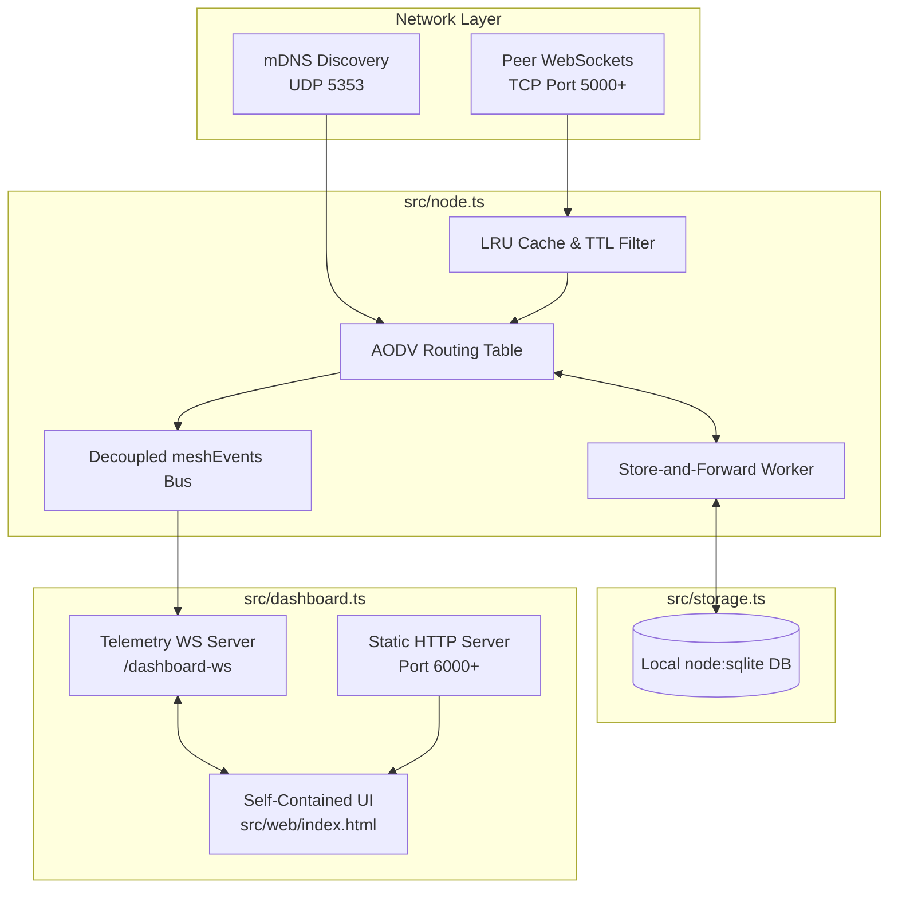

# DisasterMesh

DisasterMesh is an offline, multi-hop ad-hoc mesh communication network designed for disaster scenarios where cellular infrastructure, power grids, and global internet connectivity are down.

The system turns ordinary personal computers, single-board devices, and battery-powered portable routers into a self-healing peer-to-peer mesh. Victims can transmit emergency distress signals, intermediate nodes forward packets across devices that cannot reach each other directly, and emergency response teams can monitor and dispatch help using a self-contained local operations dashboard.

```
+-----------------------------------------------------------------------------+
|                          DISASTER ZONE TOPOLOGY                             |
|                                                                             |
|   [ Victim Node ]         [ Relay Node ]            [ Rescue Base Node ]    |
|     Port 5001               Port 5002                    Port 5003          |
|    (Water Rising)        (Forwarding Hop)           (Incident Commander)    |
|          |                       |                           |              |
|          +=== Wireless P2P ======+===== Wireless P2P ========+              |
|               (Hop 1: ~75m)             (Hop 2: ~75m)        |              |
|                                                              | (Local Bus)  |
|                                                              v              |
|                                                     [ Web Dashboard ]       |
|                                                         Port 6003           |
|                                                     (Offline Browser)       |
+-----------------------------------------------------------------------------+
```

---

## What It Does

In floods, earthquakes, and severe storms, cell towers lose grid power or fiber backhaul, leaving survivors and emergency workers disconnected. DisasterMesh resolves this by removing all dependencies on external servers, internet access, and pre-existing network infrastructure.

The software provides:

* Multi-hop packet relay: Nodes forward messages on behalf of other nodes, allowing communication far beyond the physical radio range of a single device.
* Emergency SOS triage: Victims broadcast priority distress beacons specifying incident type, trapped persons count, and local landmarks.
* Hop-proximity tracking: When GPS signals are blocked by rubble or heavy storms, the network traces the sequence of radio relays that carried the packet to estimate search radius and proximity.
* Store-and-forward queue: If a network segment splits, outbound packets are written to a local database and automatically resent once a new peer comes into range.
* Hazard bulletins: Incident commanders can broadcast mass evacuation notices and safe zone updates across the entire mesh.
* Offline command console: Rescuers manage incidents through a single-page browser console served directly by the local node, requiring zero internet access or external package downloads.

---

## System Architecture

The node architecture is divided into five modular layers:



### Component Breakdown

* Transport and Discovery (`src/discovery.ts`, `src/types.ts`): Uses multicast DNS over UDP 5353 to detect neighboring mesh nodes on the local Wi-Fi channel. Direct peer links are maintained through persistent WebSocket connections on port 5000 and above.
* Routing Engine (`src/node.ts`): Implements an ad-hoc on-demand distance vector (AODV) routing algorithm. It uses `RREQ` (Route Request) and `RREP` (Route Reply) packets to map paths on demand. A 60-second routing cache prevents network flooding, while hop-count and time-to-live (TTL) counters protect against forwarding loops.
* Store-and-Forward Engine (`src/storage.ts`): Built directly on Node.js native SQLite database (`node:sqlite`). Messages destined for unreachable nodes are saved with a `PENDING` status. An exponential-backoff retry loop periodically attempts redelivery and flushes messages the moment new peers connect.
* Epidemic Emergency Sync (`src/node.ts`): SOS alerts and safety bulletins bypass standard point-to-point routing. When two nodes establish a socket connection, they exchange open emergency alerts and missing bulletins during the mutual `IDENTIFY` handshake.
* Isolated Web Dashboard (`src/dashboard.ts`, `src/web/index.html`): Runs on an isolated port (`PORT + 1000`, e.g. 6003) separate from raw mesh traffic. The mesh engine publishes telemetry through a Node.js `EventEmitter`, keeping routing logic clean of presentation code.

---

## How It Works

### 1. Peer Discovery and Handshake
When a node starts, it advertises its device identifier and port over mDNS. When two nodes spot each other, they open a bidirectional TCP socket. The initiating node sends an `IDENTIFY` packet containing its ID. Both nodes update their neighbor tables and immediately sync any open SOS beacons stored in their local database.

### 2. Reactive Route Discovery
When node A needs to send a private message to node D:
1. Node A checks its active routing table. If no route exists, it buffers the message and broadcasts an `RREQ` packet with a random request ID.
2. Intermediate nodes B and C log a reverse path back to node A, increment the hop count, and forward the request to their neighbors.
3. When the packet hits node D, it replies with a unicast `RREP` packet along the reverse path.
4. Once node A receives the reply, it saves the next-hop address and flushes the buffered message.

```
A  ──(RREQ)──>  B  ──(RREQ)──>  C  ──(RREQ)──>  D
A  <──(RREP)──  B  <──(RREP)──  C  <──(RREP)──  D
A  ══(DATA)══>  B  ══(DATA)══>  C  ══(DATA)══>  D
```

### 3. Store-and-Forward Partition Healing
If a node drops off the network or physical distance breaks a radio link:
1. The sending node detects socket failure and invalidates that route.
2. The packet status is set to `PENDING` in SQLite with an expiration timestamp.
3. When another device moves within Wi-Fi range and connects, the background queue worker checks for pending records and forwards them automatically.

### 4. Hop-Proximity Localization
In heavy cloud cover, tunnels, or collapsed structures where GPS does not function:
1. A victim node creates an SOS packet containing its relative description (such as "2nd floor, stairwell blocked").
2. As the packet traverses the mesh, each relay appends its own device ID to the packet's `proximityChain`.
3. The dashboard analyzes the chain length. Assuming typical Wi-Fi radio range of 75 to 100 meters per hop, the system estimates the victim search radius around the nearest known relay anchor node.

---

## Offline Operations Dashboard

The dashboard provides incident commanders with live status updates during field operations.

```
+-----------------------------------------------------------------------------+
| [!] DISASTERMESH OPS COMMAND           Node-RescueBase                      |
+-----------------------------------------------------------------------------+
| DIRECT PEERS: 1        MULTI-HOP NODES: 1 (2 Total)      OPEN EMERGENCIES: 0|
+-----------------------------------------------------------------------------+
| Live Emergency Triage Queue                                                 |
|                                                                             |
| [CRITICAL] [TRAPPED] [DISPATCHED]  Node-Victim                              |
| "Water rising fast on 2nd floor rooftop"                                    |
| 4 Persons | Rooftop | 2 Hop(s) away (~200m search radius)                   |
| Topology Trace: Node-Victim -> Node-Relay -> Node-RescueBase                 |
|                                                                             |
| Assigned: Node-RescueBase | "Boat crew deployed with flotation gear"        |
+-----------------------------------------------------------------------------+
| Active Routing Table                     | Public Hazard Bulletins          |
| Node-Relay  (DIRECT, 1 hop)              | [FLOOD_SURGE] Landslide warning  |
| Node-Victim (via Node-Relay, 2 hops)     | Issued by Node-RescueBase        |
+-----------------------------------------------------------------------------+
```

Key operational capabilities:
* Live Telemetry: Streams mesh events over a local WebSocket, including new SOS alerts, peer drops, and route discoveries.
* Incident Triage: Displays incoming distress calls categorized by severity (Critical, High, Moderate) and emergency type (Trapped, Medical, Supplies, Evacuation).
* Field Dispatch: Responders can claim an incident, update status to `DISPATCHED` or `RESOLVED`, and send back tactical instructions that route directly to the victim device.
* Community Warning Broadcast: Operators can issue hazard bulletins (such as dam release or structural collapse warnings) that flood across all nodes.
* Audio Alarm: Uses the browser native Web Audio API to synthesize emergency tones on arrival of critical SOS alerts, removing the need for external audio files.

---

## Getting Started

### Prerequisites
* Node.js v22.0.0 or higher (required for built-in `node:sqlite` support)
* npm v10 or higher

### Installation

Clone the repository and install dependencies:

```bash
git clone https://github.com/hemnath-28/Disaster-Mesh.git
cd Disaster_Mesh
npm install
```

---

## Running the Demo

The repository includes an automated 3-node demo simulation representing a common disaster topology:

1. `Node-Victim` on port 5001 (isolated victim sending an emergency SOS)
2. `Node-Relay` on port 5002 (forwarding bridge node)
3. `Node-RescueBase` on port 5003 with the dashboard on port 6003 (incident commander)

Run the demo script:

```bash
npm run demo
```

The script boots all three nodes, links them in a multi-hop line topology, broadcasts an initial SOS from the victim, and starts the web console.

Open the dashboard in any browser:
```
http://localhost:6003
```

You can now:
1. Inspect the live SOS card from `Node-Victim` and view the 2-hop topology trace.
2. Click **Update Response**, assign a rescue unit, and enter instructions to dispatch a team.
3. Broadcast a new hazard warning from the dashboard form and watch it propagate across the terminal output of all three nodes.

---

## Running Individual Nodes Manually

You can also launch individual mesh nodes across separate terminal windows or different laptops on the same Wi-Fi network.

### Terminal 1: Launch Rescue Base Node with Dashboard
```bash
npx tsx src/node.ts --id Node-RescueBase --port 5003 --rescue
```
The node opens socket port 5003 and serves the web operations console at `http://localhost:6003`.

### Terminal 2: Launch Relay Node
```bash
npx tsx src/node.ts --id Node-Relay --port 5002 --peer localhost:5003
```
This node connects to `Node-RescueBase` and starts forwarding packets.

### Terminal 3: Launch Victim Node
```bash
npx tsx src/node.ts --id Node-Victim --port 5001 --peer localhost:5002
```
This node connects to `Node-Relay`.

### Trigger an SOS Alert from the Victim Node
In the victim terminal, run:
```bash
sos TRAPPED CRITICAL 4 "Water rising, 2nd floor staircase blocked" "School Building B"
```
The alert will forward through `Node-Relay` and appear instantly on the `Node-RescueBase` dashboard at `http://localhost:6003`.

---

## Running Tests

Verify the routing engine and delayed store-and-forward sync:
```bash
npm run test:mesh
```

Verify the HTTP server, WebSocket bridge, and dashboard actions:
```bash
npm run test:dashboard
```

---

## Technology Stack

| Layer | Technology | Reason Selected |
| :--- | :--- | :--- |
| Runtime | Node.js (v22+) | Cross-platform runtime supporting built-in async sockets, file operations, and SQLite without external binaries. |
| Language | TypeScript 5.8 / tsx | Type safety across packet interfaces with fast, compilation-free execution via tsx. |
| Local Storage | `node:sqlite` | Built directly into Node.js 22. Zero native compilation steps or build tools needed in disconnected environments. |
| P2P Transport | `ws` (WebSockets) | Lightweight, persistent full-duplex TCP framing supported across laptops, tablets, and local servers. |
| Local Discovery | `multicast-dns` | Zero-configuration mDNS discovery over UDP 5353 for automatic peer detection without manual IP configuration. |
| Frontend Console | Vanilla HTML5, CSS3, JS | Single self-contained file with inline styles and scripts. Zero external assets, CDNs, or node_modules dependencies. |
| Audio Alerting | Web Audio API | Generates real-time acoustic tones directly on the hardware sound chip without external audio files. |

---

## Project Status

* [x] Phase 1: Basic local peer communication
* [x] Phase 2: Automatic mDNS peer discovery
* [x] Phase 3: Multi-hop packet forwarding and hop tracking
* [x] Phase 4: AODV shortest-path route discovery and route failure handling
* [x] Phase 5: SQLite store-and-forward offline message storage
* [x] Phase 6: Emergency SOS triage, priority beacons, and hazard bulletins
* [x] Phase 9: Self-contained rescue operations dashboard
* [ ] Phase 10: Fault tolerance, network partition healing, and stress testing
